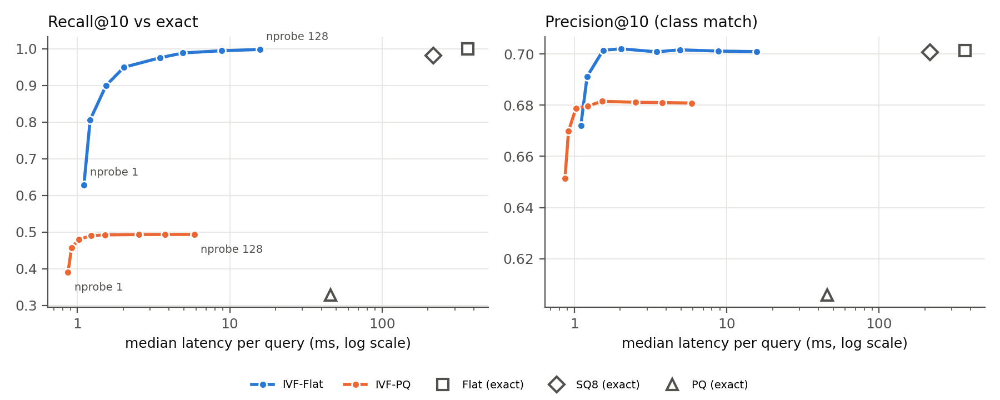

# Lab 2: Fast image search over ImageNet-1k

**Live demo: https://blongho-imagenet-image-search.hf.space**
· [Report (PDF)](report/report.pdf) · [Notebooks](submissions/) · [Assignment](instructions.md)

Given a query image, this system returns the 10 most similar of the **1,281,167 ImageNet-1k training images**.
It measures what approximate indexing (IVF) and quantization (SQ8, PQ) gain and lose compared with exact search,
in latency, memory and accuracy.

CAP6938 Homework 2, University of Central Florida, by Longho Bernard Che.

---

## What was done and why

Exact search compares the query with every database vector. It is accurate but slow (366 ms per query on a
2-core CPU) and needs about 4 GB of memory. The two standard remedies are:

- **Approximate indexing (IVF).** Group the vectors into 4,096 clusters and search only the `nprobe`
  clusters nearest the query.
- **Quantization.** Store compressed vectors: SQ8 keeps 1 byte per dimension, and PQ64 encodes each vector in
  64 bytes.

The pipeline:

1. **Embed** every image with OpenAI CLIP ViT-L/14 (768 dimensions, unit length, so inner product = cosine
   similarity). This took 0.59 h on a Colab A100.
2. **Split the data.** The database is the whole `train` split. The 1,000 queries are one image per class drawn
   at random (seed 42) from the `validation` split, so a query never finds itself.
3. **Index** with five FAISS settings that cover exact and approximate search, each with and without
   quantization.
4. **Measure** on a 2-core Colab CPU, one query at a time:
   - median and p99 latency;
   - index memory;
   - precision@10, the fraction of the top 10 in the query's class;
   - recall@10, the overlap with exact search's top 10.
5. **Analyse failures.** Comparing settings on the same query attributes each failure to the embedding model,
   the class label, the approximate index or quantization.

## Results

1,000 validation queries, IVF at nprobe = 16:

| Setting | Memory | Median latency | Speedup | Precision@10 | Recall@10 |
|---|---|---|---|---|---|
| Flat (exact) | 3,936 MB | 366 ms | 1× | 0.701 | 1.000 |
| SQ8 (exact) | 984 MB | 216 ms | 1.7× | 0.701 | 0.981 |
| PQ64 (exact) | 83 MB | 46 ms | 8× | 0.606 | 0.329 |
| IVF-Flat | 3,959 MB | 3.5 ms | 105× | 0.701 | 0.975 |
| IVF-PQ64 | 106 MB | 1.5 ms | 241× | 0.682 | 0.492 |



- **IVF buys speed, not memory.** It is 105× faster with the same precision. Raising nprobe beyond 8–16 adds
  little.
- **SQ8 buys memory, not speed.** It is 4× smaller with almost the same accuracy, but it still compares the
  query with every vector.
- **IVF-PQ buys both.** It is 241× faster and 37× smaller, for 0.02 lower precision. Its recall stays near 0.49
  whatever the nprobe: the limit comes from quantization, not from how many clusters are searched.
- **The embedding model sets the ceiling.** No setting exceeds precision 0.70. No failure came from the IVF
  index at nprobe 16; failures came from the embedding model, noisy labels and quantization.

The full analysis, with six failure cases, is in the [report](report/report.pdf). The raw numbers are in
[`results/`](results/).

## Contents

```text
lab2/
  instructions.md       assignment text
  submissions/          the three notebooks, executed on Colab with outputs
  results/              results.csv, summary.csv, failure_cases.csv and figures
  report/               report.tex and report.pdf (ACM two-column, 2 pages)
  deploy/               Hugging Face Space: index export notebook and Gradio app
  tests/                local test harness: synthetic dataset and headless notebook runner
```

## How to reproduce

The notebooks run on Google Colab and save everything to Google Drive under `MyDrive/cap6938-hw2`. Run them in
order with **Runtime → Run all**:

| Notebook | Colab runtime | What it does | Time |
|---|---|---|---|
| [`01_embed`](submissions/01_embed.ipynb) | A100 GPU, High-RAM | Embeds all training images and the 1,000 queries | about 40 min |
| [`02_index_bench`](submissions/02_index_bench.ipynb) | Standard CPU | Builds the five indexes, measures them and plots the trade-off | about 1–2 h |
| [`03_failures`](submissions/03_failures.ipynb) | Standard CPU | Selects failure cases and shows their images | a few minutes |

- **Clean run:** delete `MyDrive/cap6938-hw2` first.
- **Resume:** if a runtime disconnects, Run all again. Finished shards and settings are skipped.
- **Configuration:** every setting is a `LAB2_*` environment variable in each notebook's configuration
  cell. The defaults are the values behind the results above:
  - seed 42;
  - 4,096 IVF lists;
  - PQ with 64 sub-vectors × 8 bits;
  - 200,000 training vectors;
  - nprobe swept over 1, 2, 4, …, 128;
  - 50 warm-up queries.

  To change one, set `os.environ["LAB2_..."]` in a cell above the configuration cell.
- **Pinned packages:** `open_clip_torch==2.32.0` (model `ViT-L-14-quickgelu`, `openai` weights) and
  `faiss-cpu==1.11.0`.
- **Optional:** add an `HF_TOKEN` in Colab's **Secrets** panel for faster dataset downloads. Never put a token
  in a notebook or in this repository.

## Live demo (Hugging Face Space)

**https://blongho-imagenet-image-search.hf.space**
([Space page](https://huggingface.co/spaces/blongho/imagenet-image-search))

Upload an image, or click **Random validation image**, to get its 10 nearest ImageNet training images with
their classes and similarity scores. **nprobe** trades speed for accuracy. A search takes about 3 s in the
browser.

**How it works:**
- The app serves the benchmarked **IVF-PQ** index (106 MB).
- It runs on **ZeroGPU**, the free GPU hardware for Gradio Spaces. Only the query embedding uses the GPU, and
  each search uses a little of the visitor's daily ZeroGPU quota.
- Result images are streamed from the dataset, one parquet row group at a time. No ImageNet images are stored
  in the Space.

To deploy your own copy (code in [`deploy/`](deploy/)):

1. **Export the index.** Open [`deploy/export_index.ipynb`](deploy/export_index.ipynb) on a standard Colab
   CPU runtime, and add an `HF_TOKEN` with **write** access in Colab's Secrets panel. In a cell at the top, set
   `os.environ["LAB2_HF_ASSETS_REPO"] = "<your-username>/imagenet-clip-ivfpq"`, then Run all. It:
   - rebuilds IVF-PQ from the saved centroids and training sample;
   - checks that it reproduces the reported precision and recall;
   - uploads about 110 MB to a private dataset repository.
2. **Create the Space** at [huggingface.co/new-space](https://huggingface.co/new-space) with SDK **Gradio** and
   hardware **ZeroGPU**. Hugging Face requires PRO for Gradio Spaces on CPU basic, but free accounts can host
   up to 2 ZeroGPU Spaces.
3. **Configure it** in *Settings → Variables and secrets*:
   - a variable `ASSETS_REPO` set to your dataset repository;
   - a secret `HF_TOKEN` with **read** access.

   [`deploy/space/README.md`](deploy/space/README.md) lists the optional settings.
4. **Upload the app** after `hf auth login` with a write token. Use the Python API: `hf upload` first tries to
   create the repository, and that is refused with "402 Payment Required" without PRO.
   ```bash
   cd lab2
   python3 -c "
   from huggingface_hub import HfApi
   HfApi().upload_folder(repo_id='<your-username>/imagenet-image-search', repo_type='space',
                         folder_path='deploy/space', commit_message='Deploy image search app')"
   ```
   The Space builds and starts automatically. The first start downloads the CLIP weights (1.7 GB).

## Testing locally

[`tests/`](tests/) runs a notebook end to end on a small synthetic dataset with the real parquet schema, using
an untrained model on CPU. It checks that the pipeline runs: data handling, resume, id mapping, checks and
figures. It cannot reproduce real timings or accuracy.

```bash
cd lab2
python tests/make_fixture.py /tmp/lab2test/data
LAB2_ROOT=/tmp/lab2test/drive LAB2_LOCAL_DATA=/tmp/lab2test/data LAB2_ALLOW_CPU=1 \
LAB2_MODEL=ViT-B-32 LAB2_PRETRAINED= LAB2_NUM_WORKERS=0 LAB2_SHARDS=0-2 \
LAB2_NUM_TRAIN_FILES=3 LAB2_EXPECTED_TRAIN_ROWS=6000 LAB2_SMOKE_ROWS=256 LAB2_KEEP_PARQUET=1 \
  python tests/run_nb.py submissions/01_embed.ipynb /tmp/lab2test/out_01.ipynb <kernel>
```

`<kernel>` is the name of a Jupyter kernel with these packages installed:
- `torch`, `open_clip_torch==2.32.0`, `faiss-cpu==1.11.0`;
- `pyarrow`, `pandas`, `matplotlib`;
- `nbclient`, `huggingface_hub`.

`run_nb.py` exits with code 1 if any cell fails.

## Building the report

```bash
cd lab2/report && pdflatex report.tex   # repeat until the log has no "Rerun" warning
```

## Data and licence

The images come from
[`benjamin-paine/imagenet-1k-256x256`](https://huggingface.co/datasets/benjamin-paine/imagenet-1k-256x256) on
Hugging Face. ImageNet images may be used for non-commercial research and education only.
